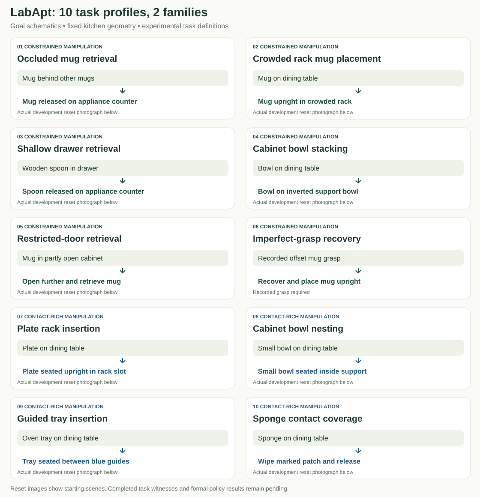
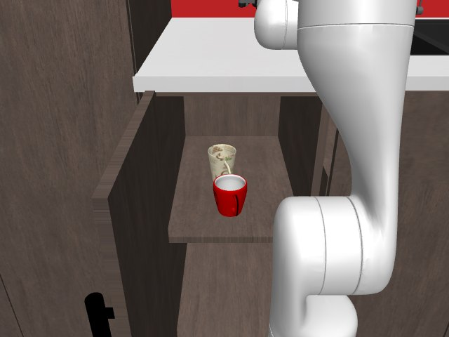
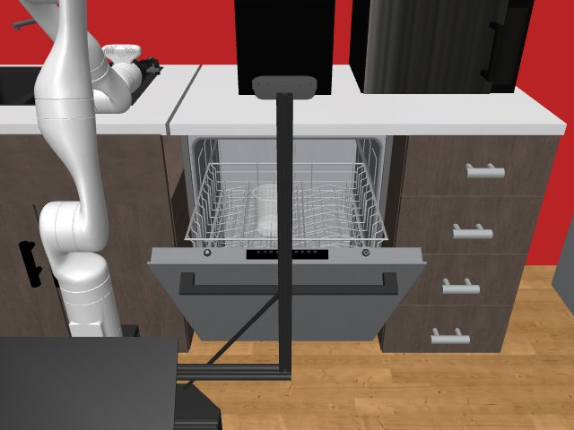
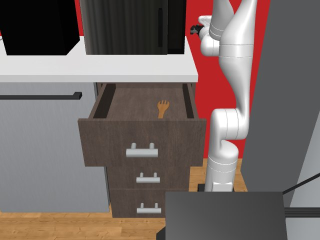
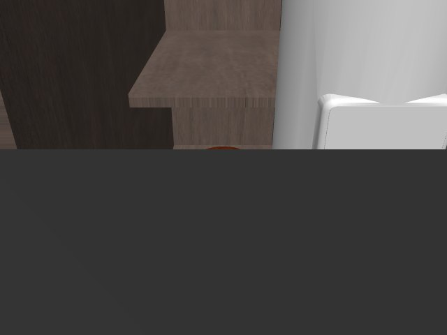
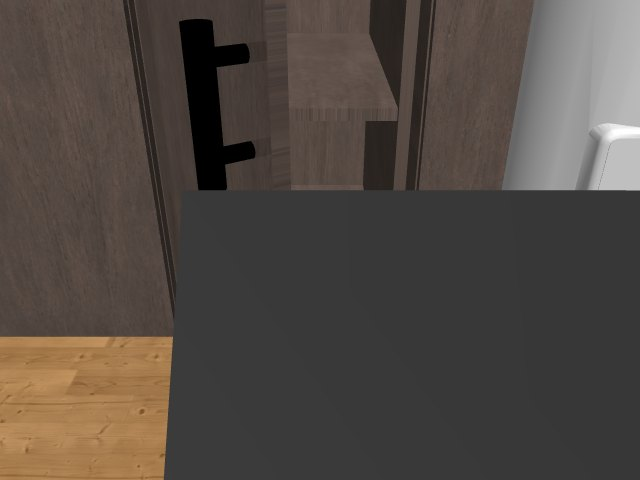
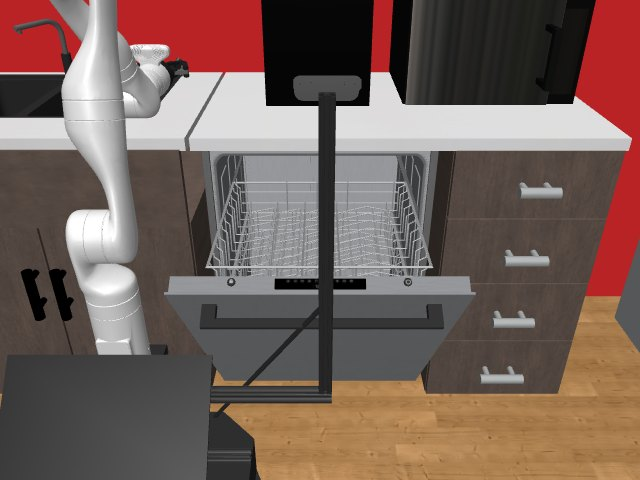
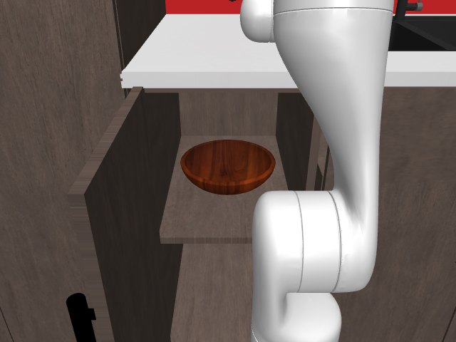
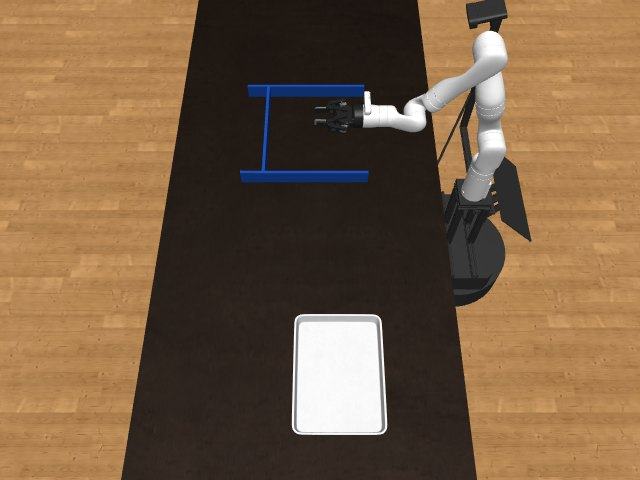
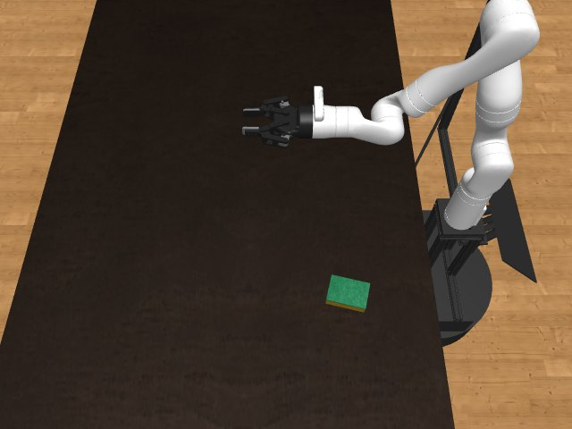

# LabApt manipulation challenge v1

Ten custom task profiles, two overlapping families, three difficulty levels and
two initialization modes. The kitchen remains measured layout 100. Existing
native tasks, layout groups, runtime pins and historical scores are unchanged.

Every profile is **experimental** until its individual scenes pass qualification.
Task implementation, valid resets, witness success, policy evaluation and physical
validation are separate evidence. The suite does not assume learning will win.

## Ten profiles in two families

**Six constrained-manipulation profiles** test access, clutter, articulation and recovery.
**Four contact-rich profiles** emphasize insertion, seating and sustained contact.
The families overlap in capabilities; these are ten profiles, not ten separate families.



### Objects, distractors and difficulty

Values below run **easy → medium → hard**. Each profile samples within its listed
object categories. A support bowl is part of the goal, rather than a distractor.

| # | Task profile | Objects present | What varies in the current implementation |
|---|---|---|---|
| 1 | **Occluded mug retrieval** (`OccludedMugRetrieval`) | 1 target mug + 1 / 2 / 3 protected mugs | Target and protected mug instances, positions and yaw. Prescribed clutter count: 1 → 2 → 3; actual occlusion needs review. |
| 2 | **Crowded rack mug placement** (`CrowdedRackMugPlacement`) | 1 target mug + 1 / 2 / 2 protected glass cups | Mug/glass instances, positions and yaw. Glass count: 1 → 2 → 2. Declared clearance: 8 → 5 → 2.5 cm; requires reviewed slot geometry. |
| 3 | **Shallow drawer retrieval** (`ShallowDrawerRetrieval`) | 1 wooden spoon; no extra distractors | Wooden-spoon instance, placement and yaw. Drawer opening: 100% → 75% → 55%; shallow-object fit still needs review. |
| 4 | **Cabinet bowl stacking** (`CabinetBowlStacking`) | 1 target bowl + 1 support bowl; no extra distractors | Bowl instances, placements and target yaw. Target scale fixed at 0.85; support scale 1.0, inverted. Alignment tolerance: 4 → 2.5 → 1.5 cm. |
| 5 | **Restricted-door retrieval** (`RestrictedDoorRetrieval`) | 1 mug; no extra distractors | Mug instance, position and yaw. Initial door opening: 65% → 45% → 25%. Cabinet remains the measured left-base cabinet. |
| 6 | **Imperfect-grasp recovery** (`ImperfectGraspRecovery`) | 1 mug; no extra distractors | Mug instance and recorded physical grasp checkpoint. Desired grasp offset: 0.5 → 1.5 → 2.5 cm. No recovery reset image or grasp recording yet. |
| 7 | **Plate rack insertion** (`PlateRackInsertion`) | 1 plate; no extra distractors | Plate instance, position and yaw. Declared clearance: 3 → 2 → 1 cm; slot bounds/orientation require reviewed geometry. Rack tines do not automatically move. |
| 8 | **Cabinet bowl nesting** (`CabinetBowlNesting`) | 1 target bowl + 1 support bowl; no extra distractors | Bowl instances, positions and yaw. Target scale fixed at 0.70; support scale 1.0, upright. Alignment tolerance: 3.5 → 2 → 1.2 cm. |
| 9 | **Guided tray insertion** (`GuidedTrayInsertion`) | 1 oven tray + fixed guide apparatus; no extra distractors | Oven-tray instance and starting position; initial yaw fixed relative to the table. Guide clearance physically changes: 3 → 2 → 1 cm, sized to the sampled tray. |
| 10 | **Sponge contact coverage** (`SpongeContactCoverage`) | 1 sponge + marked patch; no extra distractors | Sponge instance, position and yaw. Patch width: 12 → 18 → 24 cm; depth fixed at 20 cm. Goal is ≥90% contact coverage, followed by stable release. |

### Shared randomization boundaries

- **Sampled:** installed native object instances from the target asset split, bounded starting positions, and native starting yaw (normally −45° to +45° in the placement frame). Tray starting yaw is fixed. Model shape/size can differ between instances.
- **Fixed:** measured layout 100, walls, fixture dimensions/poses/appearance, table finish, object categories per profile, and the stated object scale factors. There is no additional friction perturbation, blanket fixture/material randomization or arbitrary extra clutter.
- **Distractors:** only occluded mug retrieval and crowded-rack mug placement currently add protected distractors. Their displacement limit is 2.5 cm and tilt limit is 0.15 rad. Other profiles do not silently add background objects.
- **Difficulty controls:** drawer/door opening, bowl alignment tolerances, tray-guide clearance and wiping-patch size are applied by the implementation. Rack-clearance values require an asset-specific geometry configuration and fit review; they do not automatically alter the measured rack. Occlusion and shallow-object suitability also require review.
- **Fixture selection:** cabinet tasks use the measured left-base cabinet; the drawer task uses the native eligible `TOP_DRAWER` selector. Rack tasks use the existing dishwasher. Mug-to-rack, plate, bowl, tray, sponge and recovery source surfaces use the dining table. Fixture selection is not a sweep over every cabinet.
- **Initialization:** full-workflow and manipulation-only modes are separate. Manipulation-only starts require recorded physical approach actions; recovery also requires a recorded offset grasp. A new seed does not create a new kitchen.

### Actual development reset images

These are **operator free-camera views of frozen starting scenes**, one easy workflow seed per profile. They are documentation views, separate from the policy camera observations.
They do not show completed tasks, every object, or every difficulty level.
The goal overview above explains the intended outcome when the target is occluded
or at a different station. All profiles remain experimental.

| Task | Development reset |
|---|---|
| **1. Occluded mug retrieval** |  |
| **2. Crowded rack mug placement** |  |
| **3. Shallow drawer retrieval** |  |
| **4. Cabinet bowl stacking** |  |
| **5. Restricted-door retrieval** |  |
| **6. Imperfect-grasp recovery** | Pending a physically recorded imperfect grasp; no simulated reset photograph is claimed. |
| **7. Plate rack insertion** |  |
| **8. Cabinet bowl nesting** |  |
| **9. Guided tray insertion** |  |
| **10. Sponge contact coverage** |  |

## Commands

Run with the RoboCasa dependency interpreter from this checkout:

```bash
python -m unittest discover -s cobot_integration/challenge/tests
python -m cobot_integration.challenge plan --output /new/path/plan.json
python -m cobot_integration.challenge prepare \
  --profile ShallowDrawerRetrieval --difficulty easy --mode workflow \
  --scene /new/path/drawer-scene
python -m cobot_integration.challenge qualify --scene /path/drawer-scene \
  --witness /path/successful-actions.npy --attestations /path/review.json
python -m cobot_integration.challenge evaluate --scene /path/drawer-scene \
  --controller my_policy_adapter --output /new/path/result
```

`plan` reserves disjoint development, practice and formal seed spaces. Defaults
are 20 practice and 50 formal scenes per task/difficulty/mode: 4,200 evaluation
and practice scenes across the 60 cells. Planning does not build or qualify them.
Use seeds from the plan when constructing campaign scenes. All methods reuse the
same frozen formal scenes. Do not choose scenes using RAX performance.

`prepare` refuses overwrite. Recordings and frozen model XML remain outside git.
A scene stores its recipe, source digest, native sampled-object metadata, source
model XML, physical state, temporal scoring state, initialization actions, physical gripper command state and
physical parameters. External mesh/texture files are also hashed. Editing any frozen artifact invalidates its digest.

Manipulation-only cells require `--initialization actions.npy`: recorded robot
actions from the ordinary reset to the approach checkpoint. Recovery cells also
require a physically sustained grasp and reviewed `nominal_grasp_tool_xyz` geometry;
the measured offset must match the selected difficulty within 5 mm. Never attach the object or teleport it into
the gripper. Geometry review verifies the start pose and intended grasp offset.

Rack tasks require `--geometry geometry.json` with `slot.center` and
`slot.half_extents` in the moving rack body frame, plus `slot.plate_normal_axis` for
plate insertion. Bowl tasks require an asset-specific
`seated_height_interval_m` based on collision geometry and `relationship: stack` or `relationship: nest`: stacking on an inverted support bowl
and nesting inside the cavity must have distinct intervals. These values are
operator truth, not controller inputs. Without them the relevant goal stays false.

## Qualification

A scene needs initially false success, no gross initial penetrations, nonempty
Kinect and wrist renders, stable passive settling, physical state restoration,
and a successful witness action replay twice with matching states and scoring
history. Protected-object motion and object penetrations are checked every control
step. The 5 mm screen is only a gross physics defect threshold, not insertion
clearance validation.

The review JSON must identify `scene_sha256` (SHA-256 of `scene.json`), a nonempty
`reviewer`, and true `collision_geometry_reviewed`, `primary_axis_verified`,
`initialization_verified`. Verify reachable starts, actual object/rack dimensions,
fine clearances, sampled difficulty, support surfaces and task feasibility before
signing. Review is a recorded human/engineering judgment, not automated evidence
of real-world fidelity. Do not sign a profile solely because reset succeeds.

No scene enters formal evaluation until all checks pass. A `--diagnostic` evaluation
can collect controller actions for development or witnesses; its results remain
explicitly labelled diagnostic. To refresh qualification, retain original evidence
externally and supply the new witness/review explicitly.

## Policy interface

`--controller MODULE` imports a trusted adapter exposing:

```python
def create(*, instruction, action_contract):
    return policy  # policy.act(observation) returns one 20 Hz robot action
```

The action contract includes the common CoBot action slices and normalized base-frame delta OSC
arm commands (kp 300). This is an explicit common challenge action contract,
separate from the historical RAX absolute-target tool interface. Exported controllers
must adapt their commands to this contract; historical scores are not comparable. All three controller categories use the same boundary: exported RAX
controllers, engineered feedback controllers and learned skills. Observation
contains rendered Kinect RGB/depth, wrist RGB, calibration, proprioception and
tool pose. No object poses, slot bounds, success state or fixture truth is passed.
No new force sensor is invented. This interface is trusted evaluation code, not
an OS sandbox: run untrusted generated programs through the existing isolated
RAX tool service, not as Python plugins. Wiring or running a RAX learning campaign
and training learned skills are outside this release.

Report success by task, difficulty and mode; also report attempts, completion time,
collisions, drops and recovery. Keep diagnostic, qualified formal and physical
robot results separate. Report pretraining/demonstration/development resources.

## Experimental apparatus

Guided tray insertion adds removable blue countertop guides, without modifying
measured fixtures. Tray geometry and guide fit need review. Sponge wiping measures
physical contact coverage over a 10×10 marked patch, followed by release and a
stable rest. It does not simulate cleaning chemistry or a deformable sponge.

Default numeric difficulty values are development recipes, not calibrated claims
about real-world tolerances. Changing them requires a new suite version and frozen
scenes. Rack, bowls and contact apparatus need finer collision review than the old
reset suite. No real-world validation or controller success is claimed by these
sources.

## Reproduce development checks

```bash
python -m cobot_integration.challenge.tests.runtime_smoke \
  --output /new/path/runtime-checks --jobs 3
```

This bounded check builds one easy workflow seed for each ordinary-reset profile,
renders reset illustrations, checks passive stability and exercises independent
action replay on the drawer case. It deliberately leaves recovery pending a real
recorded grasp. Passing these checks does not provide successful task witnesses
or qualify medium/hard recipes, manipulation checkpoints or real robot execution.
See `VALIDATION.json` for the exact release scope and outstanding evidence.
