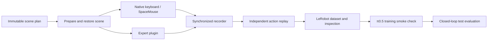

# CoBot → LeRobot → π0.5

A RoboCasa-native pipeline for human and expert demonstrations. Use the native
MuJoCo viewer with keyboard or SpaceMouse; there is no browser collector and no
RoboLab runtime dependency. Dataset generation and policy training use separate
Python environments.



## Two separate tracks

| Track | Training | Validation | Test |
|---|---|---|---|
| `transfer` | Native tasks; layouts 11/16/24/38, styles 11/22 | Layout 45, styles 33/44 | Measured LabApt layout 100, style 1 |
| `challenge` | Custom LabApt tasks, training seeds | Separate LabApt validation seeds | Separate LabApt test seeds |

Layout 100 is never transfer training or validation data. The challenge track
permits training in LabApt and must not be reported as unseen-kitchen transfer.
Each track is exported separately. Train objects use the native `pretrain`
instance split; validation/test use `target`. This is not a claim that validation
and test object instances are mutually disjoint. Seeds and scene lineages are
partitioned before collection. Repeated takes of a scene retain its lineage.
Augmentation/retargeting is not implemented by this release.

Transfer plans default to six native fixture tasks: Open/CloseDrawer,
Open/CloseCabinet and Open/CloseMicrowave. `--tasks` can select other native task
names: missing fixtures, parameters, unsupported temporal state or invalid
placements fail preparation explicitly. Native task history is serialized from
task-declared fields; non-serializable state requires an explicit adapter. The
ten custom challenges use their complete challenge-state adapter.

For different transfer kitchens, pass `plan --kitchen-config kitchens.json`:

```json
{
  "layouts": {"train": [11, 16, 24, 38], "validation": [45], "test": [100]},
  "styles": {"train": [11, 22], "validation": [33, 44], "test": [1]}
}
```

Kitchen partitions must remain disjoint; LabApt is reserved for test. Scene
preparation also checks the installed assets and the actual controller contract.
Plans declare collection targets, not successful demonstrations.

## Data and control contract

| Field | Meaning |
|---|---|
| `observation.images.kinect` | RGB, 640×360, same pre-action simulator state as wrist |
| `observation.images.wrist` | Collection wrist RGB, 640×360 with the existing native letterbox |
| `observation.state` | 18 values: q7, dq7, measured gripper closedness, measured body vx/vy/wz |
| `action` | Complete native CoBot command vector, including base-mode switching |
| `task` | Native or custom language instruction |

The clock is **20 Hz simulation time**. Every observation precedes the action
executed for the next interval. Capture, replay and policy execution share a canonical numerical boundary:
clear MuJoCo's solver warm-start guess and refresh OSC before sensor capture,
and again immediately before each action. This does not set robot/object poses or task state, and
prevents extra teacher observation calls from changing replay behavior. Commands are converted to float32 before
execution, so exported commands are the commands actually executed.

The current CoBot action order is **arm delta6, base command3, gripper command1,
base mode1**, totaling 11. Runtime slices and bounds are derived and verified;
the dataset does not assume gripper precedes base. Arm input is normalized delta
OSC in the controller's base frame, kp 300. Base commands retain native controller
scaling, and are not mislabeled as measured metres/second. The last field uses
the native positive/nonpositive mode threshold. Gripper command and measured
closedness are different quantities.

This action11 contract is **not** the older Isaac joint-target action11 contract.
No old recording is silently reinterpreted. The two image conventions are used
unchanged by collection, export and policy evaluation; no inherited 180° wrist
rotation or oracle placement-goal feature is added.

Private HDF5 audit fields retain simulator states, task history, contact flags
and phases. They are excluded from LeRobot policy features. Camera calibration
is provisional simulation calibration, not a certified physical robot match.

## Prepare and use native teleoperation

Run from this repository root with the existing RoboCasa simulator interpreter.
Use a desktop/display and the chosen input device for interactive teleoperation.
Headless rendering is sufficient for expert collection and replay.

```bash
SIM=/path/to/robocasa-runtime/bin/python
$SIM -m cobot_integration.data plan --track transfer --tasks OpenDrawer \
  --count 10 --output /new/path/transfer-plan.json
$SIM -m cobot_integration.data prepare --plan /path/transfer-plan.json \
  --index 0 --scene /new/path/scene-000

# Native RoboCasa entrypoint, native viewer and native controls:
$SIM -m robocasa.demos.demo_teleop \
  --data-scene /path/scene-000 --data-output /new/path/episode-000 \
  --device keyboard --max-steps 1800

# Equivalent pipeline entrypoint; SpaceMouse is also supported:
$SIM -m cobot_integration.data teleop --scene /path/scene-000 \
  --output /new/path/episode-001 --device spacemouse
```

`--count` is the requested number **per task, difficulty, mode and partition**.
Use a printed request `--id` instead of `--index` to select an immutable scene.
Training layout/style pairs are enumerated across the full configured product.
The native collector's ordinary defaults are preserved. Pipeline collection
skips the unrecorded reset/warm-up so prepared checkpoints remain intact.
Simulation advances only on native executed steps; pre-motion input pauses do
not produce fabricated frames. Native reset/discard and completion handling are
preserved, with a bounded step budget.

## Expert demonstrations

```bash
$SIM -m cobot_integration.data collect --scene /path/scene-000 \
  --output /new/path/expert-episode --expert my_expert --max-steps 1800
```

An importable trusted plugin exposes `run(ctx)`. It receives `ctx.instruction`,
`ctx.action_contract`, `ctx.observe()`, `ctx.action_vector(parts)`, `ctx.success`
and `ctx.step(action, phase='')`. The recorder owns all executed steps. Use
`ctx.success` rather than repeatedly polling native stateful predicates.
Plugins must not step or mutate the simulator outside this interface.

`--privileged` explicitly grants a teacher `ctx.env` for simulator-based planning;
that access is logged and never added to learner observations. The expert source
file is copied and hashed with the episode. Plugins are trusted Python code,
not a security sandbox for arbitrary generated programs.

The optional example `cobot_integration.data.examples.open_drawer` adapts the
existing experimental fixture expert to the delta controller. Its planner can
refuse other kitchens; only replay certification establishes whether an episode
is usable. An episode collected in layout 100 remains transfer **test** data.
The pipeline does not guarantee experts for every native or challenge task.

## Challenge geometry and physical checkpoints

```bash
$SIM -m cobot_integration.data plan --track challenge \
  --tasks ShallowDrawerRetrieval --difficulties easy medium hard \
  --output /new/path/challenge-plan.json
$SIM -m cobot_integration.data prepare --plan /path/challenge-plan.json \
  --index 0 --scene /new/path/challenge-scene
```

Use `--geometry geometry.json` for rack slots and bowl seating intervals, as
specified in the [challenge guide](../challenge/README.md). Rack, bowl and recovery
profiles refuse preparation without the required geometry configuration.
Manipulation mode and recovery require `--initialization actions.npy`, physically
recorded under this exact native control contract. Recovery also checks physical
gripper contact, the requested offset and a one-second stable grasp. There are
no welded or teleported grasp initializations.

All challenge demonstrations also require an engineering review to qualify:

```json
{
  "scene_id": "ID from scene.json",
  "source_sha256": "source fingerprint from scene.json",
  "reviewer": "reviewer identity",
  "collision_geometry_reviewed": true,
  "primary_axis_verified": true,
  "initialization_verified": true
}
```

A successful replayed demonstration supplies the witness; the review supplies
asset-specific geometry/initialization judgment. Neither alone qualifies a task.

## Replay, export and inspect

```bash
$SIM -m cobot_integration.data validate --episode /path/episode-000
# For challenge data, also supply --review /path/review.json.

# Separate writer environment:
uv venv --python 3.11 /path/lerobot-writer
uv pip install --python /path/lerobot-writer/bin/python 'lerobot==0.4.4' h5py
WRITER=/path/lerobot-writer/bin/python
$WRITER -m cobot_integration.data export \
  --episodes /path/episode-000 /path/episode-001 \
  --track transfer --split train --repo-id local/cobot-transfer-train \
  --output /new/path/lerobot-train
$WRITER -m cobot_integration.data inspect --dataset /path/lerobot-train
```

Only successful, completed, contact-screened, independently replayed episodes
enter an imitation dataset. Replay restores initial state/history once and then
executes recorded actions; it does not correct the robot with future states.
It compares every state18/action row, physical states, task history and sampled
camera images. Validation attempts are retained separately. Failed, interrupted
and discarded captures remain auditable and cannot be exported as successes.
Valid corrective motions inside successful episodes remain in the data.

Exports contain real LeRobot v3 Parquet, metadata and H.264 videos. Inspection
checks all numeric rows, language labels, episode boundaries and sampled decoded
images. Cross-track, cross-split, duplicate-trajectory and incompatible-contract
merges are rejected. Validation/test exports are separate, and training commands
reject their use as training data. Normalization uses only the training export.
The raw captures remain available for inspection; training reads the standalone
LeRobot export without requiring simulator truth.

Outputs refuse overwrite. Retry into a new directory; do not edit raw files or
rewrite histories to make certification pass. For larger collections, iterate
planned requests through `prepare`, `collect` and `validate`, then pass accepted
episodes to `export`. This release does not launch a full campaign automatically.

## π0.5 smoke check and evaluation

The training pin is LeRobot commit `b9cb121cb7d4e3e26ec5c906d08dda68d151ba52`.
Use its separate Python 3.12 environment and optional `pi`/`training` dependencies.
Model and tokenizer pins are recorded by `train-smoke`. Local snapshots must be
HF cache snapshots at the pinned revision, or carry a hashed `snapshot.json`
with repository/revision/file digests. No model is downloaded automatically.

```bash
$SIM -m cobot_integration.data train-smoke --dataset /path/lerobot-train \
  --output /new/path/pi05-smoke --python /path/pi05-env/bin/python \
  --lerobot-root /path/pinned-lerobot \
  --model /path/pinned-pi05-snapshot --tokenizer /path/pinned-tokenizer \
  --execute
```

This validates episode-local 50-action chunks and launches two optimizer updates,
batch size 1, gradient checkpointing and expert-only fine-tuning. Full training
is a separate configuration, not a claimed result of this smoke check. Omitting
`--execute` performs data/preparation checks only. Missing dependencies, weights
or CUDA are written as explicit blockers; exit code 2 means the full smoke check
did not pass. No Hub uploads or online experiment logging are enabled.

A successful run stores `cobot_data.json` beside its saved checkpoint, binding
the controller/camera contract and training collection. To test that checkpoint:

```bash
$SIM -m cobot_integration.data evaluate --scene /path/test-scene \
  --checkpoint /path/checkpoint/pretrained_model \
  --python /path/pi05-env/bin/python --output /new/path/pi05-evaluation
```

The model runs in its dependency interpreter over a private local socket. The
simulator executes the first five predicted actions and replans, using the same
observation and command contract. Native bounds are applied and clipping is
reported. No recorded actions replace model predictions. Challenge evaluation
also requires `--witness /path/certified-test-demonstration` for that exact scene.
GUI operation, replay validation and policy competence are separate evidence.

## Checks and provenance

```bash
python -m unittest discover -s cobot_integration/data/tests -v
```

See `VALIDATION.json` for the release's actual simulator/export checks and any
missing training prerequisites. Large raw captures, datasets and checkpoints
stay outside git. Frozen source fingerprints intentionally reject changed code;
historical episode certificates retain their original source identities.

The bounded NPZ transport is adapted from RoboLab's Apache-2.0 implementation;
its notice and license are retained in `protocol.py` and `LICENSE.protocol`.
The pipeline has no import or runtime dependency on RoboLab.
